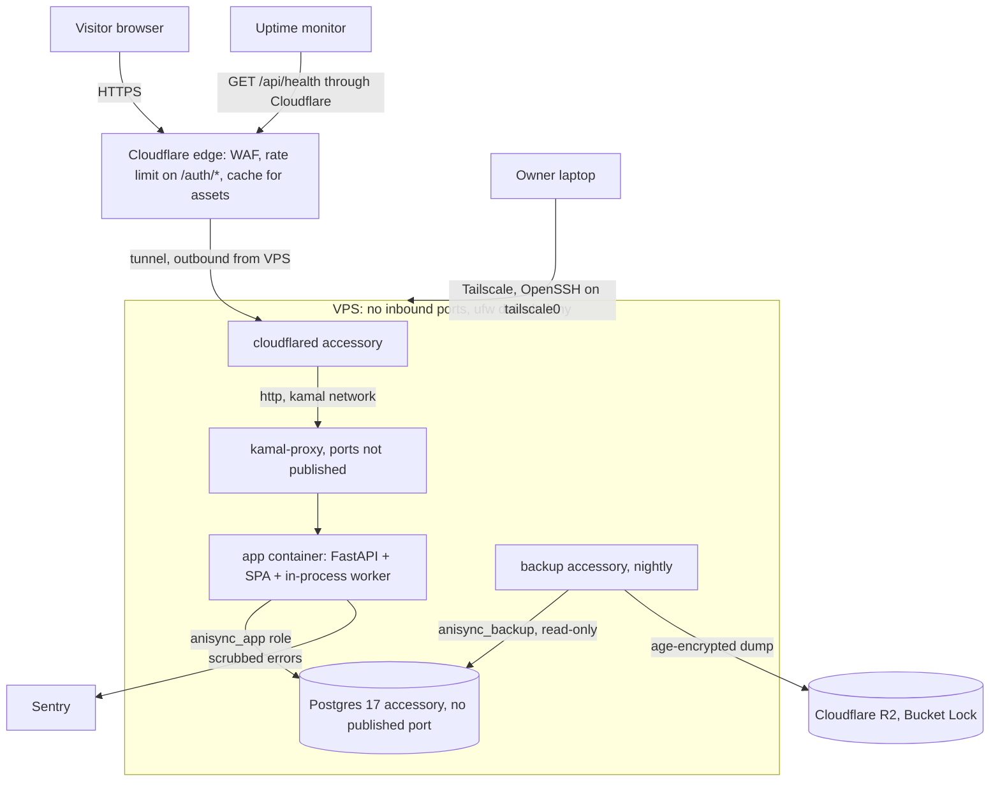
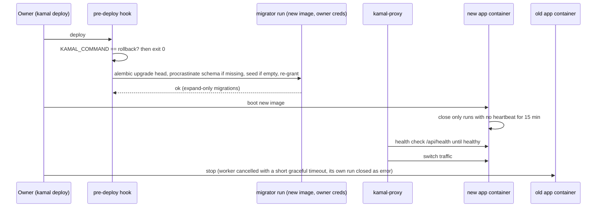
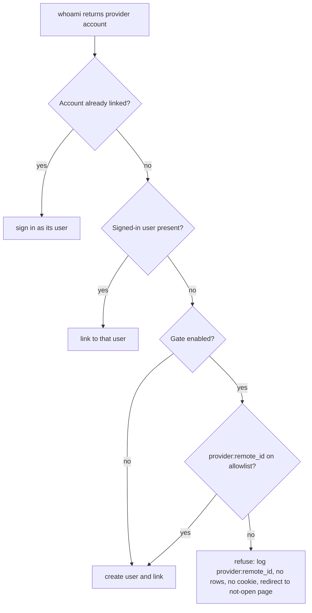

# Production Deploy and Real-World Test - Plan

---

## Goal Capsule

- **Objective:** AniSyncHub runs in production on a server nobody can reach except through Cloudflare, invited testers can sign in and sync real lists, and the behaviours never tried at real size (2000+ entry lists, MAL as a mirror, production OAuth apps) have been tested on real accounts, with the public launch still gated on the providers' written answers.
- **Means:** One VPS behind a Cloudflare Tunnel, deployed with Kamal 2, Postgres as a Kamal accessory, admin access only over Tailscale (KTD1, KTD2).
- **Authority:** This plan's Requirements win on behaviour; its KTDs win on mechanism. `AGENTS.md` and `CODING_STANDARDS.md` bind every unit. `docs/ROADMAP.md` Decisions (funding, branding, provider terms) are not reopened here.
- **Execution profile:** One change set on `main` (the project commits straight to `main`). Code and config units first, then the runbook. The manual checklists in U8 run after the first deploy and record their results in `docs/ROADMAP.md`.
- **Stop conditions:** Stop and ask if a provider's answer arrives that changes what may be stored or written (MAL "no" changes the design, outside this plan). Stop if Kamal's pre-deploy hook cannot be skipped on rollback (KTD6) and no other guard is found.
- **Who finishes:** An agent builds U1–U7 and writes U8. The owner does the steps that need accounts and credentials: VPS, domain, Cloudflare, Tailscale, R2, Sentry, provider app registration, the provider messages, and the manual checklists.

---

## Product Contract

### Summary

Package AniSyncHub as one container that serves the API, the background worker and the built frontend from one address, and deploy it with Kamal to a VPS whose only public entrance is a Cloudflare Tunnel. Add the few app changes that production behind this chain needs: real visitor IPs, a closed sign-in gate, deploy-safe sync runs, a real health check and scrubbed error reporting. Back up the database off the machine with a tested restore, and write the runbook that takes the owner from an empty VPS to a tested deployment.

### Problem Frame

AniSyncHub is built and tested, but only on the owner's machine. Three behaviours have never run at real size or against production settings: lists of 2000+ entries (measured only on 976), writes to MAL when MAL is a mirror, and sign-in through MAL and AniList apps registered for a production address. Running the app on a public server also changes things the local setup hides. Every request arrives through proxies, so per-IP rate limits would treat all visitors as one. Deploys start a new container while the old one is still syncing. Errors go nowhere anyone sees. And MAL's API agreement and AniList's terms leave open questions that block a public launch until each answers in writing (see `docs/ROADMAP.md`, Phase 6), so a deployed site must not be open to strangers just because it has an address.

### Key Decisions

- **Self-host on one VPS behind Cloudflare, deployed with Kamal.** (session-settled: user-directed — chosen over Railway and over Cloudflare Pages + Neon + Render: Cloudflare in front for WAF, rate limiting and bot protection, no open inbound ports.) Governs R1, R2, R3.
- **Postgres as a Kamal accessory on the same VPS.** (session-settled: user-approved — chosen over managed Postgres: private, no network latency, direct connections for the job queue's notifications and the per-user advisory lock, no extra party holding user data.) Governs R9, R10.
- **Sign-in stays closed until the providers answer.** Only allowlisted provider accounts can create an AniSyncHub user in production; opening it is a config change at launch. Governs R5, R6.
- **The donation link ships off.** The platform is still undecided (ROADMAP Open questions); the link appears only once a URL is configured. Governs R14.

### Requirements

**Hosting and access**

- R1. The server accepts no inbound connections from the internet: the public reaches the app only through a Cloudflare Tunnel, and SSH is reachable only over Tailscale.
- R2. The frontend and the API are served from the same public address, so session cookies and the CSRF origin check keep working unchanged.
- R3. A deploy replaces the running version without downtime, and a rollback to the previous image works after a deploy that added a migration.
- R16. Other sites cannot frame AniSyncHub's pages, so its buttons (unlink, delete account, sign out everywhere) cannot be clickjacked.

**Correctness behind proxies**

- R4. Per-IP rate limits count each visitor's real IP; a client cannot choose its own IP by sending forwarding headers or by rotating addresses within one IPv6 /64.

**Closed access**

- R5. In production, a provider account that is not on the allowlist cannot create an AniSyncHub user, and a refused sign-in leaves no user, linked account, token or session behind.
- R6. Signed-in users keep linking further accounts, and existing users keep signing in with accounts they already linked, whatever the allowlist says.
- R7. Development, tests and the e2e server keep open sign-in unless they turn the gate on.

**Sync runs during deploys**

- R8. A deploy never lets two syncs run at once for the same user, and never marks a sync that is still making progress as interrupted.

**Data protection**

- R9. The database has no published port. The app connects as a role that can read and write data but cannot change the schema; migrations run as a separate owner role whose credentials neither the app container nor the backup container ever holds. (The database container already holds the superuser password, so it also creates the other roles.)
- R10. The database is backed up nightly, encrypted, to storage off the VPS. A restore has been performed and checked, without the restored copy touching any provider.

**Visibility**

- R11. Unexpected errors reach Sentry without request bodies, cookies, OAuth codes, tokens or passwords.
- R12. An outside uptime check fails when the app cannot reach its database or its in-process worker has stopped.

**Real-world verification**

- R13. Sign-in through production-registered MAL and AniList apps, MAL as a mirror (creates, updates, deletes), and a 2000+ entry list on each provider have each been run on real accounts, with the measured numbers recorded in `docs/ROADMAP.md`.

**Launch prerequisites**

- R14. A donation link appears in the footer only when a donation URL is configured; it is one-off only per ROADMAP Decisions.
- R15. The messages to MAL, AniList and Kitsu are tracked with what each must ask and what a "no" would block; opening sign-in waits on MAL's and AniList's answers.

### Acceptance Examples

- AE1. Covers R5. **Given** production with the gate closed and `mal:1001` (Alice's MAL id) allowlisted, **when** Bob (MAL id 2002) completes MAL sign-in, **then** he lands on a "not open yet" page, the database has no new user, linked account or session row, and the log shows `mal:2002` was refused.
- AE2. Covers R6. **Given** Alice is signed in, **when** she links Kitsu (not on the allowlist), **then** the link succeeds because no new user is created.
- AE3. Covers R4. **Given** the deployed chain, **when** a request arrives with a forged `X-Forwarded-For: 1.2.3.4`, **then** the app records the sender's real IP, not `1.2.3.4`.
- AE4. Covers R8. **Given** a sync that has been running for 20 minutes and committed a batch 30 seconds ago, **when** a new container starts, **then** that run stays `running` and a second sync for the user is refused.

### Success Criteria

- The owner can go from an empty VPS to a working deployment by following `docs/deploy.md` alone.
- First full sync of a 2000+ entry list completes on each provider without manual intervention, and its time and request count are recorded.

### Scope Boundaries

- Redesigning storage or MAL writes after MAL's answer (ROADMAP: "decide the design only after the answer").
- Ads, provider logos, multi-worker or multi-server setups (the shared rate limiter stays deferred, per ROADMAP Phase 3).
- Considered and not built: an admin screen for the allowlist. The gate is temporary and holds a handful of testers; an env change plus redeploy is enough. Would change if the beta grows past what a config line can hold.
- Considered and not built: point-in-time recovery (WAL archiving). A nightly dump loses at most a day at tens of users. Would change once real users rely on it.
- Considered and not built: Cloudflare Bot Fight Mode. On the free plan it cannot be skipped for `/api` or OAuth callbacks and may challenge the app's own requests.

#### Deferred to Follow-Up Work

- Opening sign-in to the public: flips the gate after MAL and AniList answer (R15).
- The donation platform choice (ROADMAP Open questions).
- Retrying procrastinate jobs left in `doing` by a killed worker beyond what the next scheduled sync already repairs.

---

## Planning Contract

### Key Technical Decisions

- KTD1. **Cloudflare Tunnel as a Kamal accessory, pointed at kamal-proxy.** cloudflared runs with a tunnel token on Kamal's Docker network and forwards to `http://kamal-proxy:80`. kamal-proxy runs with `ssl: false` and `proxy.run.publish: false` (Kamal 2.12) so ports 80/443 are not published; Docker-published ports would bypass ufw. `proxy.forward_headers: true` is set explicitly, because it is only true by default while `ssl` is false and KTD4 depends on it. No accessory gets a `port:`. (session-settled: user-directed — chosen over Railway: see Key Decisions.) Governs R1, R3.
- KTD2. **SSH over Tailscale with plain OpenSSH bound to the tailnet.** Kamal connects to the server's tailnet name. Plain OpenSSH rather than Tailscale SSH, because Kamal's Ruby SSH client with Tailscale SSH is unverified. ufw denies all inbound except on `tailscale0`. Governs R1.
- KTD3. **The container serves the built SPA.** A multi-stage image builds the frontend. Assets are served only through `StaticFiles`; a `GET` catch-all always returns the one `index.html` and never builds a file path from the request, so no path can escape `dist`. The catch-all never answers `/api`, `/api/…`, `/auth` or `/auth/…` (segment match, so `/apiary` is a client route). A small middleware adds `X-Frame-Options: DENY`, `Content-Security-Policy: frame-ancestors 'none'`, `X-Content-Type-Options: nosniff` and `Referrer-Policy: strict-origin-when-cross-origin` to every response (R16). Rejected: Cloudflare Pages on another hostname, which breaks `SameSite=Lax` cookies and the `Origin == PUBLIC_URL` CSRF check. Governs R2.
- KTD4. **Trust forwarded headers only from the pinned Docker network.** The `kamal` network gets a fixed subnet; uvicorn runs with `--proxy-headers --forwarded-allow-ips=<that subnet>`. uvicorn walks `X-Forwarded-For` from the right and stops at the first untrusted hop, which is the visitor's IP that cloudflared appended; client-supplied entries to its left are ignored. Rejected: `--forwarded-allow-ips="*"`, which returns the leftmost, forgeable entry. Rejected for now: reading `CF-Connecting-IP`, because kamal-proxy's `--client-ip-header` is not exposed in Kamal 2.12 config and the app would need its own trust check. `ratelimit.client_id` buckets IPv6 addresses by their /64, since one host controls a whole /64. Governs R4.
- KTD5. **Closed-access gate in config, checked before a user is created.** Settings `SIGNUP_ALLOWLIST_ENABLED` (default on when `is_production`, off otherwise; `config/deploy.yml` also sets it to `true` explicitly, so an `http://` typo in `PUBLIC_URL` cannot open the gate) and `SIGNUP_ALLOWLIST` (comma-separated `provider:remote_id`). It matches on the provider's stable account id, never the username, because AniList and MAL allow renames and anyone could rename into a listed name. The check runs in `api/auth.py` `_link_account` right after `whoami()` and only on the branch that would create a new `User`, before any `User`, `LinkedAccount` or token write. A refused sign-in logs `provider:remote_id` at info level and raises a dedicated error that both auth routes turn into a redirect to a "not open yet" page with no session cookie. Bootstrap: the owner signs in once, gets refused, copies their `provider:remote_id` from the log into the allowlist and redeploys. `ADMIN_USER_IDS` is set only after reading the owner's actual user id, because `bootstrap_admins` promotes whoever holds that id. Governs R5, R6, R7.
- KTD6. **Migrations in a Kamal pre-deploy hook, as the owner role, skipped on rollback.** The hook runs the new image once with `docker run --rm --env-file` pointing at a 0600 file on the VPS that holds the owner credentials; neither the app's nor the backup accessory's `env.secret` list contains them. It applies `alembic upgrade head`, applies the procrastinate schema only when its tables are missing, seeds the ID dataset only when the media table is empty, and then re-runs the KTD8 grants so objects created by any other role are covered too. It exits without migrating when `KAMAL_COMMAND` is `rollback`. Migrations stay expand-only (add columns or tables, never drop or rename in the same deploy that stops using them), so the previous image keeps working after a rollback. Rejected: migrating in the container entrypoint, which puts owner credentials in the app container. Governs R3, R9.
- KTD7. **Sync runs go stale by lack of progress, not by age.** `sync_runs` gets `heartbeat_at`. It is set when the run starts, at every phase boundary (each snapshot read, each mirror's plan), on every batch commit, and before every rate-limit pause, so no gap between heartbeats approaches 15 minutes even on a 2000+ entry first sync. "Stale" becomes "no heartbeat for 15 minutes". Startup cleanup stops closing every open run and closes only stale ones, and `running_run` (the one-sync-per-user check) uses the same rule. A container stopped mid-sync must close its own run as `error`. Today it would not: procrastinate 3.11's graceful shutdown waits for running jobs with no timeout, so Docker kills the container before `run_sync`'s handler runs. `lifespan` therefore passes a short `shutdown_graceful_timeout` (about 20 s) to `run_worker_async`, and Kamal's stop timeout for the app is set above it. Procrastinate then cancels the running sync, `run_sync`'s existing `BaseException` handler closes the run as `error`, and the next scheduled sync plans again from snapshots. Rejected: a separate Kamal worker role, which has the same overlap and adds a second container to deploy. Governs R8.
- KTD8. **Three least-privilege roles, created by a shell init script.** A shell init script (it reads passwords from the accessory's secret env; a `.sql` file could not) creates:
  - `anisync_owner`: owns the schema and runs migrations. The db accessory's secret env (which already holds the superuser password) supplies the owner, app and backup passwords to the init script; the 0600 migrator env file holds the same owner password.
  - `anisync_app`: CONNECT, USAGE, SELECT/INSERT/UPDATE/DELETE on tables and USAGE on sequences, through `ALTER DEFAULT PRIVILEGES FOR ROLE anisync_owner` plus an explicit `GRANT … ON ALL TABLES/SEQUENCES` that the pre-deploy hook re-runs (KTD6). Write access to `alembic_version` is revoked.
  - `anisync_backup`: member of `pg_read_all_data`, used only by the backup job, so no always-on container holds owner rights.

  The procrastinate schema is applied by the owner, so its tables get the same grants. No migration creates extensions, so no superuser is needed at runtime. Governs R9.
- KTD9. **Backups: `pg_dump -Fc`, encrypted with age, to R2.** A backup accessory runs nightly, encrypts with an age public key (the private key never touches the VPS), uploads to an R2 bucket with a lifecycle rule (30 daily copies) and Bucket Lock against deletion. The restore drill restores into a throwaway Postgres and boots the image against it with `PUBLIC_URL=http://localhost:<port>` (non-production settings, so U3's provider-secret check does not apply and no production callback is reachable), `RUN_WORKER_IN_PROCESS=false`, no scheduler, provider credentials blanked and only the escrowed token encryption key supplied, and checks row counts plus that one token decrypts with the escrowed key. The age private key and the token encryption key together expose every token, so both live in the owner's password manager and are loaded only for the drill. The R2 token on the VPS can write only to the backup bucket. Governs R10.
- KTD10. **Sentry with scrubbing at init.** `sentry-sdk` with the FastAPI integration, enabled only when `SENTRY_DSN` is set. Init options: `send_default_pii=False`, `max_request_body_size="never"`, `include_local_variables=False` (the auth callback's locals hold codes and tokens, and providers hold client secrets), and `traces_sample_rate=0`. A `before_send` and `before_breadcrumb` pass exception values, messages, breadcrumbs, the request URL and `request.query_string` through `logs.redact`. They also drop query strings on `/auth/*` URLs, because Sentry's logging integration reads log records before the redacting filter on the handlers runs. Governs R11.
- KTD11. **Health checks the database and the worker.** `/api/health` runs `SELECT 1` and, when the worker runs in-process, reports unhealthy if its task has finished. It is public through Cloudflare, so a failure returns a fixed body with no detail, and the DB check runs with a short statement timeout (kamal-proxy waits 5 s). kamal-proxy's healthcheck path points at it; the external uptime monitor (Better Stack or UptimeRobot) checks it through Cloudflare, so it also catches a down tunnel. Governs R12, R3.
- KTD12. **Image registry: Kamal's local registry over SSH.** Kamal 2.8+ can push through `registry.server: localhost:5555` over the SSH connection, so deploys from the owner's machine need no external registry. GHCR stays the fallback if CI deploys later. Governs R3.

### High-Level Technical Design

Request path and admin path:

Deploy and rollback:

Closed-access decision in `_link_account`:

### Assumptions

- The owner has or will buy a domain on Cloudflare and a VPS with at least 2 GB RAM (Postgres, the app and the seed import's ~120 MB peak).
- Kamal 2.12 runs the pre-deploy hook on `kamal rollback` with `KAMAL_COMMAND=rollback` set; U5 verifies this before relying on it (Stop conditions).

---

## Implementation Units

### U1. Deploy-safe sync runs and a real health check

- **Goal:** A deploy can neither close a live sync nor allow a second one, and `/api/health` reports a dead database or worker.
- **Requirements:** R8, R12, R3; KTD7, KTD11.
- **Dependencies:** none.
- **Files:**
  - `backend/src/anisync/models.py` (`SyncRun.heartbeat_at`)
  - `backend/migrations/versions/<new>_sync_run_heartbeat.py` (add column, backfill from `started_at`)
  - `backend/src/anisync/sync.py` (`start_run`, `refresh_snapshot`, mirror planning, batch commits, rate-limit pauses in `_write`, `close_interrupted_runs`, `running_run`, `RUN_STALE_AFTER` meaning)
  - `backend/src/anisync/main.py` (`lifespan` stops passing `everything=True`, passes `shutdown_graceful_timeout`, keeps the worker task reachable for health)
  - `backend/src/anisync/api/routes.py` (`/health`)
  - `backend/tests/test_sync_running.py`, `backend/tests/test_api_routes.py`
- **Approach:**
  1. Add `heartbeat_at` (nullable, indexed with `finished_at` if the stale query needs it) and set it at every point KTD7 lists.
  2. Base staleness on `coalesce(heartbeat_at, started_at)`; use it in both `close_interrupted_runs` and `running_run` so the two never disagree.
  3. Startup closes only stale runs; drop the `everything` path.
  4. Pass the graceful shutdown timeout from KTD7 to the in-process worker.
  5. `/api/health` returns 503 with a fixed body when `SELECT 1` fails or times out, or the in-process worker task is done (KTD11).
- **Patterns to follow:** `test_a_crash_is_closed_even_when_the_rollback_expires_everything` for forcing production-like session behaviour; existing advisory-lock comment in `start_run`.
- **Test scenarios:**
  - Covers AE4. A run started 20 minutes ago with a heartbeat 30 seconds ago survives startup cleanup and blocks a second `start_run` for the same user.
  - A run with no heartbeat for 16 minutes is closed as `interrupted` at startup and no longer blocks a new sync.
  - Each batch commit moves `heartbeat_at` forward (fake provider with 60 changes, three batches).
  - A fake provider whose read phase and rate-limit pauses advance the clock past 15 minutes in steps: the run is never treated as stale and a second `start_run` is refused throughout.
  - A run that raises still ends `error` with `finished_at` set (existing behaviour unchanged).
  - Cancelling the in-process worker during a long fake sync ends that run `error` with `finished_at` set within the graceful timeout.
  - `/api/health` answers 200 with a reachable DB and a live worker task, 503 when the worker task has finished, 503 when the DB query fails.
  - A 503 body is the same fixed text in both failure cases and contains no exception text.
- **Verification:** The new tests pass; the migration applies and downgrades on `anisync_test`.

### U2. Closed-access sign-in gate

- **Goal:** In production only allowlisted provider accounts can create a user; everything else about sign-in and linking is unchanged.
- **Requirements:** R5, R6, R7; KTD5.
- **Dependencies:** none.
- **Files:**
  - `backend/src/anisync/config.py` (two settings, default tied to `is_production`)
  - `backend/src/anisync/api/auth.py` (`_link_account`, both callback/password routes' error handling)
  - `backend/.env.example`
  - `frontend/src/pages/Static.tsx` (a "not open yet" page) and its route
  - `backend/tests/test_auth_and_api.py`, `frontend/src/pages/app.test.tsx`
  - `backend/e2e/server.py` (gate explicitly off)
- **Approach:**
  1. Parse the allowlist once into a set of `(provider, remote_id)`; reject entries for unknown providers at settings load.
  2. In `_link_account`, check only on the branch where `user is None and account is None`, before `User(...)` is constructed.
  3. Raise a dedicated exception; the redirect callback and the Kitsu password route both translate it to the "not open yet" outcome without setting the session cookie (Kitsu cannot create a user anyway, since it needs a signed-in user; the check guards it regardless).
- **Patterns to follow:** existing `PermissionError` path for "account belongs to another user"; `moderation` ban handling for the redirect shape, but not its ordering (it commits before refusing).
- **Test scenarios:**
  - Covers AE1. Gate on, `mal:2002` not listed: callback redirects to the not-open page, `users`, `linked_accounts` and `user_sessions` row counts are unchanged, no session cookie is set, and the log names `mal:2002`.
  - Gate on, `mal:1001` listed: a new user is created and signed in.
  - Gate on, an account whose username equals a listed entry's text but whose id differs: refused.
  - `SIGNUP_ALLOWLIST=foo:1` (unknown provider) refuses to load.
  - Covers AE2. Gate on, signed-in user links an unlisted Kitsu account: linked.
  - Gate on, an already-linked account that is not on the list signs in: allowed.
  - Gate off (non-production default): an unlisted account creates a user.
  - Production settings with no explicit setting: gate is on.
  - Frontend: the not-open page renders its message and a link back to the landing page.
- **Verification:** Backend and frontend tests pass; the e2e suite still passes with the gate off.

### U3. Production settings, real IPs and Sentry

- **Goal:** Production refuses to start misconfigured, rate limits see real IPs, and errors reach Sentry scrubbed.
- **Requirements:** R4, R11; KTD4, KTD10.
- **Dependencies:** none.
- **Files:**
  - `backend/src/anisync/config.py` (`_production_needs_real_secrets`: require provider client ids/secrets for registered redirect providers; normalize `PUBLIC_URL` by stripping a trailing slash; `SENTRY_DSN`)
  - `backend/src/anisync/main.py` (Sentry init)
  - `backend/src/anisync/ratelimit.py` (`client_id` buckets IPv6 by /64; update the proxy note to the KTD4 setup)
  - `backend/pyproject.toml`, `backend/uv.lock` (`sentry-sdk[fastapi]`)
  - `backend/tests/test_hardening.py` (production settings, Sentry scrubbing), `backend/tests/test_logs.py`, `backend/tests/test_ratelimit.py`
- **Approach:** Keep IP trust in uvicorn flags (U4 sets them) rather than app code. The Sentry hooks follow KTD10; put them in a small function that tests can call with a hand-built event.
- **Patterns to follow:** existing production refusal of weak `SESSION_SECRET` and missing encryption keys; `logs.redact` tests.
- **Test scenarios:**
  - Production settings with a missing `MAL_CLIENT_SECRET` refuse to load, naming the setting.
  - `PUBLIC_URL=https://example.org/` builds the callback `https://example.org/auth/mal/callback` (single slash).
  - `before_send` on an event whose request URL and `query_string` carry `code=abc&state=xyz` leaves neither value anywhere in the event.
  - An exception value and a breadcrumb message containing `Bearer abc123` come out redacted.
  - Sentry init options include `include_local_variables=False`, `send_default_pii=False` and `max_request_body_size="never"`.
  - With no `SENTRY_DSN`, Sentry is not initialized.
  - Two IPv6 addresses in the same /64 share one rate-limit bucket; addresses in different /64s do not; IPv4 is unchanged.
- **Verification:** Tests pass; `uv run ruff check` and format are clean.

### U4. Container image serving API, worker and SPA

- **Goal:** One image runs the whole app and serves the frontend from the same origin.
- **Requirements:** R2, R4, R16; KTD3, KTD4.
- **Dependencies:** U3.
- **Files:**
  - `Dockerfile` (multi-stage: Node build of `frontend/`, uv-based Python runtime, non-root user)
  - `.dockerignore`
  - `backend/src/anisync/main.py` (static assets mount and SPA catch-all, only when the built `dist` exists, registered after every API route)
  - `backend/src/anisync/security.py` (security-headers middleware, next to the CSRF and request-ID middleware)
  - `backend/tests/test_api_contract.py` (catch-all on the public list; the route walk must not count it as an API route without a schema)
  - `backend/tests/test_spa.py` (new; catches route shadowing, misses the real image build)
- **Approach:**
  1. Serve hashed assets with long cache headers and `index.html` with `no-cache`.
  2. The catch-all follows KTD3: `GET` only, always the one `index.html`, segment match on `/api` and `/auth`; unknown `/api/*` stays a JSON 404.
  3. The container command runs uvicorn with `--proxy-headers --forwarded-allow-ips` set from an env var holding the pinned `kamal` subnet (KTD4).
- **Patterns to follow:** `api/public.py` for public routes; the contract test's public list.
- **Test scenarios:**
  - `GET /settings` with a built `dist` returns `index.html`; `GET /assets/<hash>.js` returns the file with an immutable cache header.
  - `GET /api/does-not-exist` returns a JSON 404, not `index.html`.
  - `POST /some-page` is not answered by the catch-all.
  - `GET /..%2F..%2Fetc/passwd` and `GET /assets/../../pyproject.toml` return `index.html` or 404, never a file outside `dist`.
  - `GET /apiary` returns `index.html`; `GET /api` and `GET /auth` do not.
  - Every response, including `index.html` and an `/api` JSON response, carries `X-Frame-Options: DENY`, `frame-ancestors 'none'`, `nosniff` and the referrer policy.
  - Without a `dist` directory (dev and tests), no catch-all is mounted.
- **Execution note:** Mostly packaging; prove it by building the image and running it locally against the compose Postgres before U5.
- **Verification:** The image builds; running it locally serves the landing page and `/api/health` on one port.

### U5. Kamal deployment, tunnel and database roles

- **Goal:** `kamal setup` on a fresh VPS brings up Postgres, the tunnel, the backup job and the app, with migrations run as the owner and the app holding only data rights.
- **Requirements:** R1, R3, R9; KTD1, KTD2, KTD6, KTD8, KTD12.
- **Dependencies:** U4.
- **Files:**
  - `config/deploy.yml` (service, image, local registry, app stop timeout above the KTD7 graceful timeout, `proxy` with `ssl: false`, `forward_headers: true`, `run.publish: false`, healthcheck path `/api/health`; accessories `db`, `cloudflared`, `backup`; pinned network subnet; `SIGNUP_ALLOWLIST_ENABLED: true`)
  - `.kamal/secrets` (reads values from the environment or a password manager; holds no literals; the owner password reaches only the db accessory, per KTD8)
  - `.kamal/hooks/pre-deploy` (rollback guard, migrator run and re-grant per KTD6)
  - `deploy/postgres-init/01-roles.sh` (three roles and their privileges per KTD8)
  - `.gitignore` (local env files)
- **Approach:**
  1. Verify first that Kamal 2.12 sets `KAMAL_COMMAND=rollback` for the hook; if not, guard on the version being deployed already having been migrated (record which is used).
  2. Procrastinate schema: check for its jobs table before applying, since a second apply fails.
  3. Seed only when `media` is empty, so a redeploy never re-imports.
  4. The app env carries `DATABASE_URL` for `anisync_app` and the backup accessory carries `anisync_backup`; only the 0600 migrator env file on the VPS carries `anisync_owner`.
- **Test expectation:** none in the test suite — config and shell. Proven by the first deploy in U8 and by a dry run against a local VM or the VPS before DNS points at it.
- **Verification:** On the VPS, `kamal setup` then `kamal deploy` twice succeeds; a second deploy does not re-seed or fail on the procrastinate schema; `kamal rollback` to the previous version works; `ss -tlnp` shows no listener on public interfaces except Tailscale; connecting as `anisync_app` cannot `CREATE TABLE` or write `alembic_version`; `docker inspect` of the app and backup containers shows no owner credentials.

### U6. Encrypted off-machine backups and restore drill

- **Goal:** A nightly encrypted dump lands in R2, and the restore procedure is scripted and proven.
- **Requirements:** R10; KTD9.
- **Dependencies:** U5.
- **Files:**
  - `deploy/backup/Dockerfile` and `deploy/backup/backup.sh` (pg_dump as `anisync_backup`, age, S3 upload to R2, exit non-zero on any failure)
  - `deploy/backup/restore-drill.sh` (fetch latest, decrypt locally, restore into a throwaway Postgres, run the checks)
  - `config/deploy.yml` (`backup` accessory schedule and env)
- **Approach:** `backup.sh` pings an uptime-monitor heartbeat URL only after a successful upload, and the monitor alerts when no ping arrives within about 26 hours. That catches a backup that never ran, which no failure report can. A failed run also reports to Sentry for detail. The drill runs on the owner's machine and handles keys per KTD9.
- **Test expectation:** none in the test suite — scripts. Proven by running the drill (U8).
- **Verification:** A dump object appears in R2 after the first night; the drill restores it, row counts match production's at dump time, one stored token decrypts with the escrowed key, and the app booted against the copy with the worker off makes no provider request.

### U7. Donation link setting

- **Goal:** The footer shows a one-off donation link only when one is configured.
- **Requirements:** R14.
- **Dependencies:** none.
- **Files:**
  - `backend/src/anisync/api/public.py` (`SiteOut.donation_url`, from settings; https only)
  - `backend/src/anisync/config.py` (`DONATION_URL`, empty by default)
  - `frontend/src/ui/Chrome.tsx` (`Footer`), `frontend/src/api/types.ts`
  - `backend/tests/test_switches.py` (`/api/site`), `frontend/src/pages/app.test.tsx`
- **Approach:** The non-affiliation line and dataset credits already exist in `Footer`; add only the optional link.
- **Test scenarios:**
  - No `DONATION_URL`: `/api/site` returns `donation_url: null` and the footer shows no link.
  - `DONATION_URL=https://ko-fi.com/x`: the footer shows the link.
  - An `http://` value is refused at settings load.
- **Verification:** Tests pass.

### U8. Deployment runbook and real-world checklists

- **Goal:** One document takes the owner from an empty VPS to a tested production, and records the real-world results.
- **Requirements:** R1, R10, R13, R15, and the operational half of R3, R4, R12.
- **Dependencies:** U1–U7.
- **Files:**
  - `docs/deploy.md` (new)
  - `docs/ROADMAP.md` (Phase 6 checkboxes, results, provider message status)
  - `AGENTS.md` (Commands: deploy, migrations policy; Stack: hosting row now settled)
  - `README.md` (status line, link to `docs/deploy.md`)
- **Approach:** Sections, in order:
  1. Prerequisites and accounts: domain on Cloudflare, VPS, Tailscale, R2 bucket with lifecycle and Bucket Lock, uptime monitor with a backup heartbeat check, age key pair (private key stored off the VPS), Sentry project, uptime monitor.
  2. VPS hardening: ufw default deny with `tailscale0` allowed, OpenSSH listening only on the tailnet, unattended upgrades, Docker installed by Kamal.
  3. Cloudflare: tunnel and public hostname, SSL "Full", Always Use HTTPS, HSTS, Bot Fight Mode off, the one rate-limiting rule on `/auth/*`, cache rule bypassing `/api/*` and `/auth/*`.
  4. Provider apps: register MAL and AniList with `https://<domain>/auth/<provider>/callback`.
  5. First deploy and the bootstrap order from KTD5: sign in, copy the refused `provider:remote_id` from the log, add it, redeploy, sign in, then read the owner's user id and only then set `ADMIN_USER_IDS`.
  6. Post-deploy checks: AE3 forged-header test against the rate-limit log; health and uptime alert test by stopping the app; a Sentry test error with a fake `code` in the URL that must arrive scrubbed; response headers include the anti-framing headers (R16).
  7. Manual checklists (R13): production OAuth sign-in on MAL and AniList; MAL as a mirror on a throwaway or exported list, preview first, then create, update and delete; 2000+ entry lists on each provider with first-sync time, request count, Kitsu page shrinking and rate-limit waits recorded.
  8. Restore drill (U6) and how often to repeat it.
  9. Provider messages (R15): what each asks (from ROADMAP), sent date, answer, and what flips the gate.
  10. Migrations policy: expand-only, and why (KTD6).
- **Test expectation:** none — documentation and manual verification.
- **Verification:** Every Phase 6 checkbox in `docs/ROADMAP.md` is either ticked with recorded results or explicitly waiting on a provider answer.

---

## Verification Contract

| Gate | Command or check | Proves |
|---|---|---|
| Backend lint | `cd backend && uv run ruff check src tests && uv run ruff format --check src tests` | U1–U4, U7 style and S-rules |
| Backend tests | `cd backend && uv run pytest -q` (compose Postgres running) | U1, U2, U3, U4, U7 |
| Frontend | `cd frontend && npm run lint && npm test && npm run build` | U2, U7, SPA build for U4 |
| E2E | `cd frontend && npm run e2e` | Sign-in and sync flows unchanged with the gate off (R7) |
| Image | Build the `Dockerfile` and run it locally against the compose DB | U4 |
| Deploy | First deploy, second deploy, rollback on the VPS | U5, R3 |
| Live checks | `docs/deploy.md` post-deploy checks | R1, R4, R11, R12 |
| Restore | Restore drill | R10 |
| Real world | Manual checklists with numbers in `docs/ROADMAP.md` | R13 |

---

## Definition of Done

- U1–U4 and U7 have their tests written and passing in CI; lint and format are clean.
- The image builds, and the first deploy, a second deploy and a rollback have each succeeded on the VPS.
- The live checks pass: no public listeners besides Tailscale, forged `X-Forwarded-For` ignored, health failure alerts, Sentry event scrubbed, anti-framing headers present.
- A backup exists in R2 and the restore drill passed.
- R13's checklists are run, or each unrun item names the account or provider answer it waits on, in `docs/ROADMAP.md`.
- `AGENTS.md`, `README.md` and `docs/ROADMAP.md` describe the deployed setup; `CODING_STANDARDS.md` is checked for a rule this work established (expand-only migrations if a review finds it worth one).
- No dead-end code from abandoned approaches remains in the diff; no secret or env file is committed.

---

## System-Wide Impact

| Surface | What changes | Covered by |
|---|---|---|
| Rate limiter (`ratelimit.client_id`) | Sees real IPs via trusted proxy headers; IPv6 bucketed by /64 | KTD4, U3, U4 |
| CSRF middleware (`security.py`) | Unchanged: `origin_of` already drops path and trailing slash, so `PUBLIC_URL` normalization is safe | U3 |
| Sessions and OAuth state cookies | `Secure` follows the https `PUBLIC_URL`, unaffected by the proxy | none needed |
| Sign-in (`api/auth.py`) | New refusal branch before user creation | KTD5, U2 |
| Admin bootstrap (`moderation.bootstrap_admins`) | Unchanged code; set `ADMIN_USER_IDS` only after the owner's user exists | KTD5, U8 |
| Sync runs and the one-sync-per-user check | Staleness measured from the last heartbeat | KTD7, U1 |
| e2e server (`backend/e2e/server.py`) | Its http `PUBLIC_URL` keeps the gate off; set it explicitly anyway | U2 |
| Every HTTP response | Security headers added | KTD3, U4 |
| Database privileges | App and backup lose schema rights; owner credentials stay out of the app and backup containers | KTD8, U5 |

---

## Risks & Dependencies

| Risk | Mitigation |
|---|---|
| The pre-deploy hook runs on rollback and fails on an unknown revision | KTD6 guard, verified first in U5; expand-only migrations |
| Cloudflare or the tunnel is down while the app is healthy | Uptime monitor checks through Cloudflare, so either failure alerts |
| Backups silently stop | Heartbeat monitor alerts on a missed nightly ping (U6) |
| A deploy lands mid-sync and Kamal's stop timeout is shorter than expected | Stop timeout set above the graceful timeout (KTD7, U5); watch the first deploy during a sync |
| A restored copy syncs real lists or burns refresh tokens | Drill runs with the worker off and provider credentials blanked (KTD9) |
| MAL-as-mirror test damages a real list | Use a throwaway or exported list and run the preview first (U8) |
| AniList throttling during the 2000+ test | Existing rate-limit waits; record the numbers rather than tuning in this plan |
| A provider answers "no" | Stop condition; redesign is outside this plan |

---

## Sources & Research

- `docs/ROADMAP.md`: Phase 6 items, Decisions (funding, branding), provider terms findings, "Not verified yet".
- `backend/src/anisync/main.py` `lifespan` and `sync.close_interrupted_runs(everything=True)`: the rolling-deploy overlap KTD7 fixes.
- `backend/src/anisync/ratelimit.py` `client_id` (`request.client.host`) and its proxy note: KTD4.
- `backend/src/anisync/api/auth.py` `_link_account`: where KTD5's check sits; `sessions.py` sets `Secure` from an https `PUBLIC_URL`.
- Kamal 2.12 proxy options (`ssl`, `run.publish`), local registry in Kamal 2.8+, and kamal-proxy's `X-Forwarded-For` handling; uvicorn 0.54 `ProxyHeadersMiddleware` right-to-left trust walk; Cloudflare free-plan limits (Bot Fight Mode not skippable, one rate-limiting rule, five WAF custom rules). Details and URLs: research notes from this planning run.
